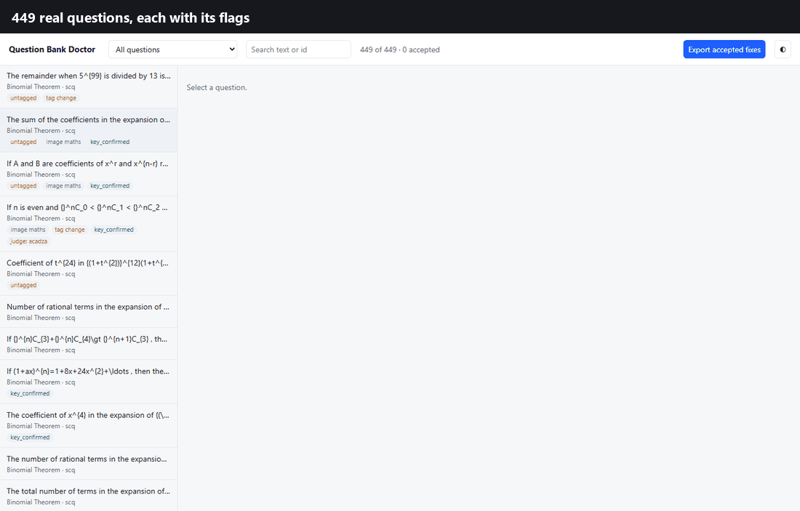
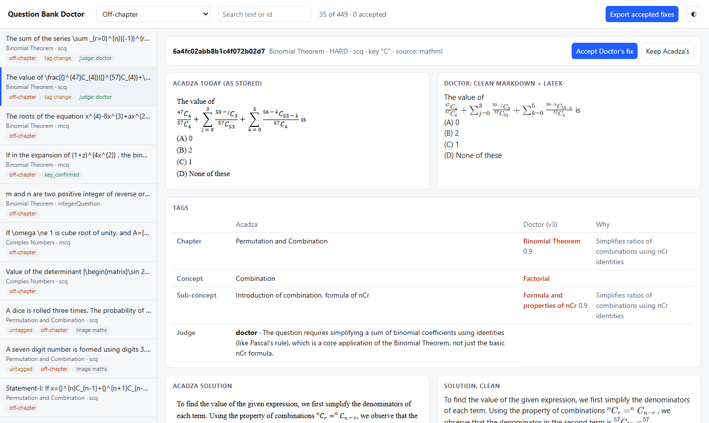
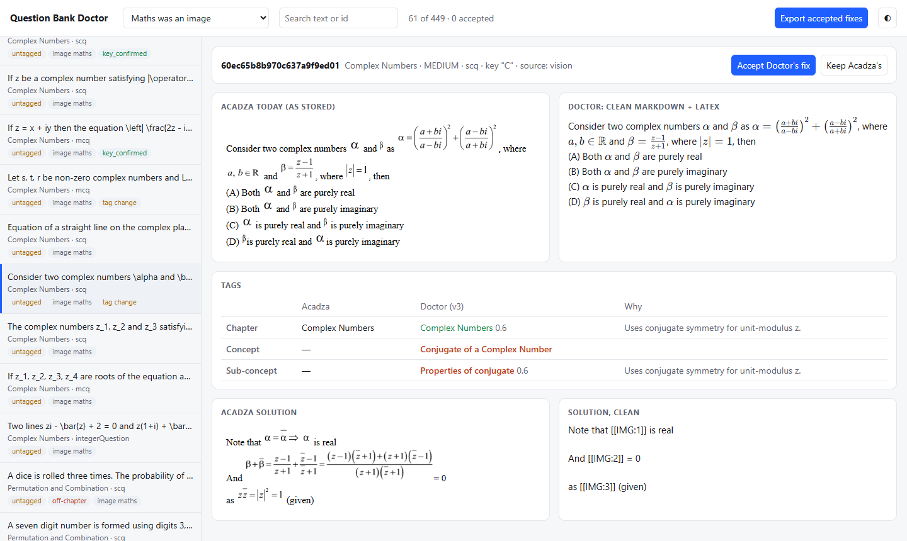
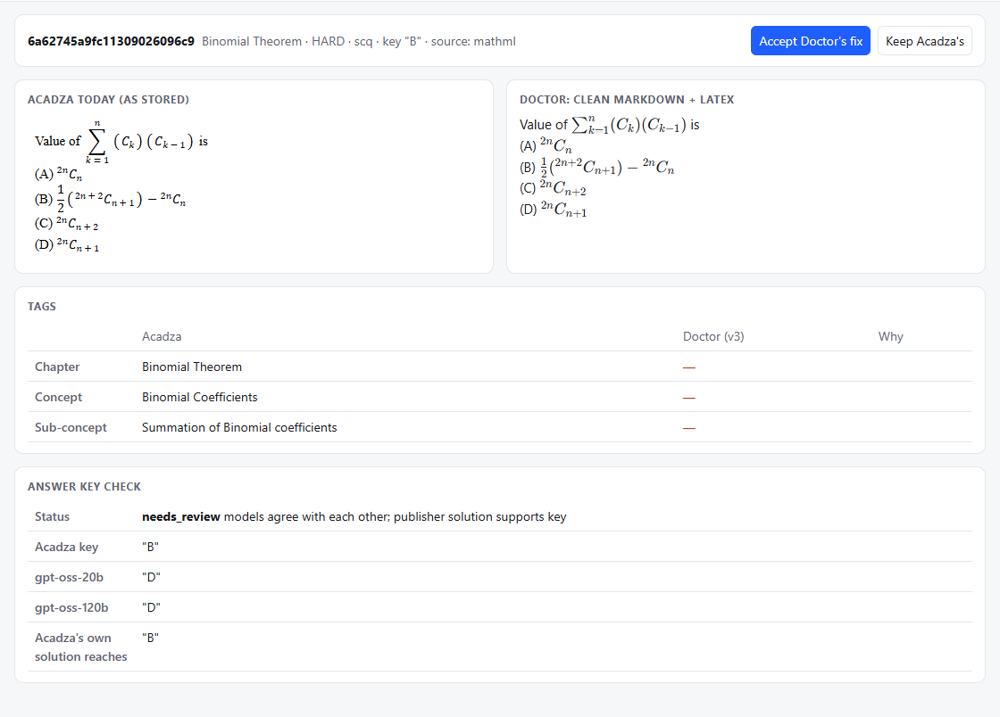
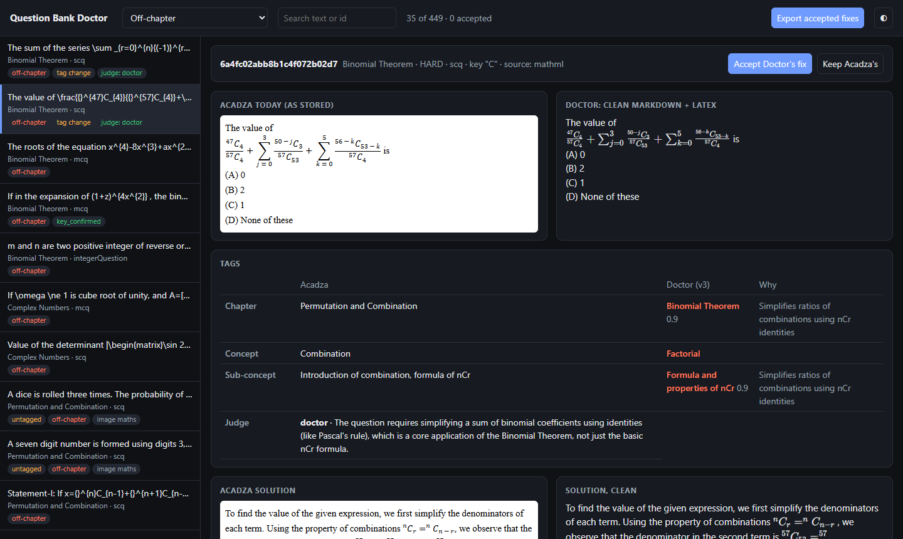
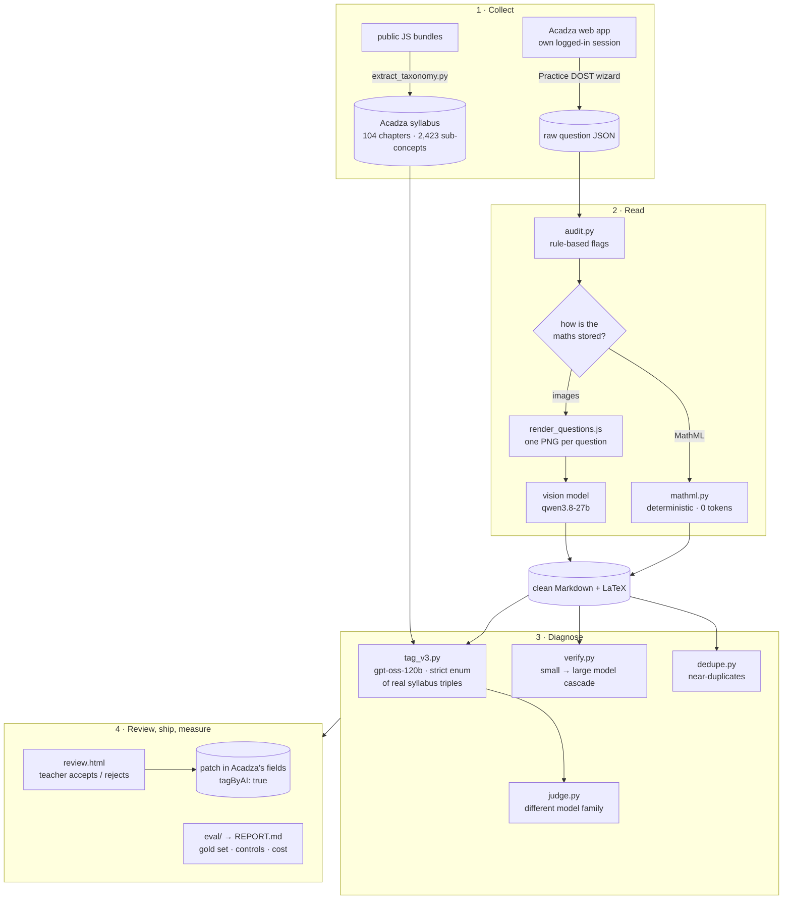
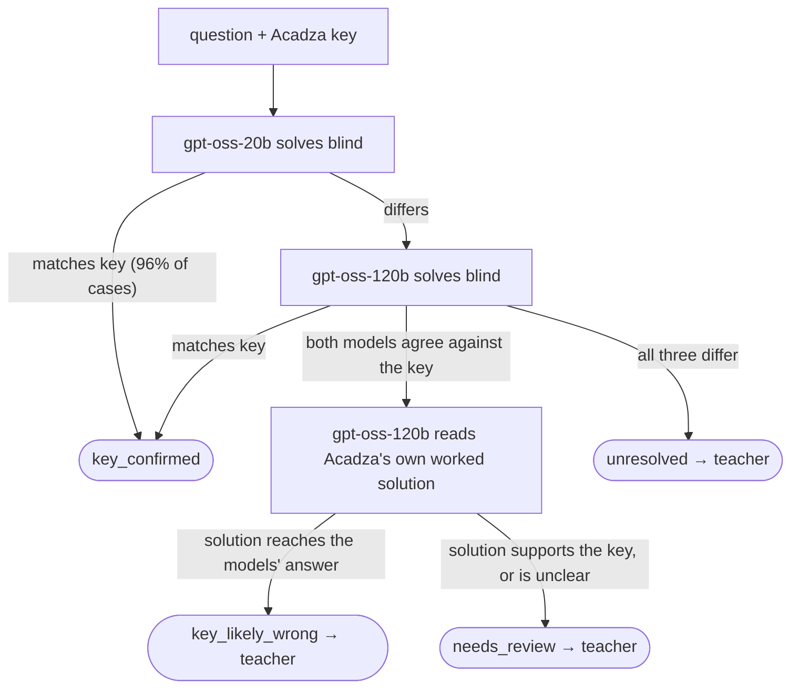

<div align="center">

# 🩺 Acadza Question Bank Doctor

**An AI pipeline that audits and repairs Acadza's JEE question bank, in Acadza's own format and syllabus, and shows
its evidence for every change.**




*The review screen running on real output: filter → compare → check the evidence → accept → export a patch.*

</div>

---

## The 60-second version

> **Chanakya is already strong. What holds it back is the data underneath it.** I audited 449 real questions served
> by the Practice DOST and built a tool that fixes the problems it finds, with a teacher in the loop.

| Finding | Why it matters |
|---|---|
| 🏷️ **1 in 5 questions has no sub-concept tag** | Danger areas, remedies, backlog plans and adaptive difficulty all work at sub-concept level, so these questions are invisible to them. |
| 🖼️ **14% of questions (18% of solutions) store maths as images** | Neither Chanakya nor search can read them. The Doctor transcribes them to LaTeX (5 / 5 spot-checked exact). |
| 🧭 **7.8% are served in an assignment for a different chapter** | One binomial-coefficient question is tagged *Hyperbola*. The Doctor says which side is wrong: the tag or the selector. |
| ✅ **126 / 127 answer keys confirmed, 1 real defect found** | A single-correct question with two correct options. A small model settles 96% of keys, for **under $0.001 per key**. |
| ⚠️ **My first tagger was *worse* than Acadza's tags** | It scored 12 / 30 against Acadza's 27 / 30 on a hand-labelled gold set, which caught it before it touched the bank. v3 reads Acadza's own sub-concept definitions and scores 12 / 13 so far. |

**This is triage, not an oracle.** The Doctor turns a question bank into a short, evidence-backed list that a teacher
can clear in minutes. It exports the accepted fixes in Acadza's own fields (`chapter`, `concept`, `subConcept`,
`tagByAI: true`, `questionMarkdown`).

## Screenshots

<table>
<tr>
<td width="50%"></td>
<td width="50%"></td>
</tr>
<tr>
<td><b>Off-chapter question.</b> Acadza files it under <i>Permutation and Combination</i>. The Doctor proposes
<i>Binomial Theorem → Formula and properties of nCr</i> and gives a reason, and a judge from a different model family
agrees.</td>
<td><b>Image maths → LaTeX.</b> The question is rendered and read by a vision model. It had no concept or
sub-concept tag; now it has one from Acadza's syllabus.</td>
</tr>
<tr>
<td></td>
<td></td>
</tr>
<tr>
<td><b>Answer-key check.</b> Two models answer (D), the key says (B), and Acadza's own solution reaches (B).
Solving it by hand showed that <b>both are correct</b>: a real defect in a single-correct question.</td>
<td><b>Dark mode</b>, plus filters for untagged questions, image maths, low confidence and judge verdicts.</td>
</tr>
</table>

## Architecture



**Cheap models first; expensive ones only where they change the outcome.** Answer keys go through a cascade, so the
large model and the publisher's solution are used only when needed:



**Every tag is a real syllabus entry.** The tagger sees only the concept → sub-concept trees of 2–3 candidate
chapters. It must answer with one exact `(chapter, concept, subConcept)` triple from a strict JSON-schema `enum`, so
it can't invent a syllabus entry or misspell one.

## What this unlocks for Acadza

- **Sub-concept DOSTs that cover the whole bank:** danger areas, remedies, backlog plans and formula sheets gain the
  ~21% of questions they can't place today.
- **Chanakya that can read a student's own questions:** today it asks for a screenshot. With clean Markdown + LaTeX
  it can read them as text.
- **The "Adaptive (Coming soon)" level:** adaptive difficulty first needs sub-concept tags and answer keys you can
  trust. This is that groundwork.
- **A content-quality gate:** the same pipeline can check every new upload before students see it, so the bank stays
  clean.

## If I joined: the first 30 days

| Week | Plan |
|---|---|
| 1 | Finish the Maths run (limited only by API quota); have a teacher sign off on the gold set and the flagged keys. |
| 2 | Run Physics and Chemistry (the pipeline and syllabus file already cover them). Calibrate tagger confidence against teacher decisions so that confident cases can skip review. |
| 3 | Plug the review screen into the content team's workflow, writing straight to `tagByAI` / `questionMarkdown`. |
| 4 | Run it nightly on newly added questions; publish a bank-health dashboard (untagged %, image-only %, off-chapter %). |

## Why this, and not another chatbot
Acadza already has a strong AI assistant (Chanakya: tool use, memory, multi-step study journeys, Hinglish). What holds
it, and most DOSTs, back is the **data underneath**. An audit of 449 real questions served by the app found:

| Finding | Share |
|---|---|
| No concept / sub-concept tag | **20.7%** |
| Solution maths stored as images | **18.0%** |
| Question maths stored as images | **13.6%** |
| Question served in an assignment for a different chapter | **7.8%** |
| Sub-concept tag doesn't match the syllabus string (whitespace) | 2.9% |
| Tagged by AI or by a teacher (`tagByAI`, `taggedByCoachingTeacher`) | 0% |

Every feature that works at sub-concept level (danger areas, backlog plans, remedies, formula sheets, adaptive
difficulty, Chanakya reading a student's questions) depends on clean text and correct tags. The full list of app
issues found during the walkthrough is in **[ISSUES.md](ISSUES.md)**.

## Status

| Stage | What | Status |
|---|---|---|
| 0 | Extract Acadza's syllabus from the public JS bundles | ✅ done: 104 chapters, 884 concepts, 2,423 sub-concepts (JEE) |
| 1 | Collect real questions through the normal assignment wizard | ✅ done: 18 assignments, 449 unique questions |
| 2 | Rule-based baseline audit | ✅ done: `doctor/audit.py` |
| 3 | Clean Markdown + LaTeX: MathML by code; image maths by vision (`qwen/qwen3.8-27b`) | 🟡 questions 430 / 449 (19 waiting for quota); solutions 368 / 449 (81 image-only, transcribed by `run_all.py --solutions`). Vision spot-check 5 / 5 exact |
| 4 | Re-tag to the syllabus: v1 → v2 → **v3** (`gpt-oss-120b`, strict enum of exact syllabus triples) | 🟡 v1 complete (rejected, see below); v3 on the evaluation set in progress |
| 5 | Answer-key check: `gpt-oss-20b` → `gpt-oss-120b` → read Acadza's own solution | ✅ 127-question sample: 126 confirmed, 1 real defect (two correct options); 1 earlier false alarm traced to a Doctor bug and fixed. 14 results being re-checked after the glued-LaTeX fix |
| 6 | Near-duplicate detection | ✅ 2 pairs; not a real problem in this sample |
| 7 | Judge for tag disagreements (different model family) | 🟡 18 judged so far (grows as v3 tags more) |
| 8 | `REPORT.md` + `app/review.html` | ✅ generated from whatever is finished; rerun to refresh |

**Everything left is limited by Groq's free tier** (about 200K tokens/day per model, rolling 24h). Resume with:
```bash
.venv/Scripts/python -I run_all.py            # every stage, skips finished work, stops cleanly at the daily limit
.venv/Scripts/python -I run_all.py --reports  # only rebuild REPORT.md and review.html
```

## What the evaluation found (so far)
- **The first tagger was worse than Acadza's existing tags.** On 30 hand-labelled chapter disagreements, Acadza was
  right 27 times and v1 only 12. v1 saw chapter *names* only and used its own meaning of them (binomial remainder
  problems went to "Mathematical Reasoning", which in JEE means logic). Shipping v1 would have damaged the bank. The
  gold set is what caught it.
- **v3 uses Acadza's own sub-concept definitions** (e.g. remainders live under *Binomial → Application → Last digits*).
  Result so far: 12 / 13 on the gold set, 11 / 11 controls kept. The run is still filling in; quote it only once all 30 / 40 are done.
- **Answer keys are in good shape:** 126 of 127 checked keys were confirmed by an independent solve. The cascade
  flagged 2. Hand-solving showed one is a real question defect (two correct options in a single-correct question,
  ISSUES.md #18). The other was **a bug in the Doctor**: a `<`/`>` in LaTeX was eaten by an HTML-tag strip, deleting an
  option from 39 questions. Fixed, re-processed, and kept on the record. A third Doctor bug, LaTeX operators without a
  trailing space (`A∩B` → undefined `\capB`; `\cdot p` → `\cdotp`, which silently drops the `p`), garbled 43
  questions and 150 solutions. Also fixed, with affected tags and key checks re-run.
- **Tagger confidence is not usable yet.** Its high-confidence answers agree with Acadza *less* often than its
  low-confidence ones (REPORT.md §3), so it can't be used to skip review.
- **Conclusion:** the AI's value here is *triage*. It narrows 449 questions down to a short, evidence-backed list for a
  teacher, and every flag is checkable. It is not an oracle.

## Pipeline design
For each question:
1. **Read:** MathML → LaTeX with a deterministic converter (`doctor/mathml.py`, no tokens). For maths stored as images,
   the whole question is rendered to one PNG (`collect/render_questions.js`) and transcribed by a vision model, which
   gets the known text as context and only fills in the gaps.
2. **Tag (v3):** candidate chapters = {chapter the assignment asked for, Acadza's chapter, v1's chapter}. The model
   sees the full concept → sub-concept tree of only those chapters and must pick one exact triple (strict JSON
   `enum`). If Groq's constrained decoding still emits an invalid value, the question is retried alone, then
   snapped to the nearest valid entry and marked `snapped`.
3. **Verify:** `gpt-oss-20b` solves blind; only on disagreement does `gpt-oss-120b` solve; only if both agree against the
   key does `gpt-oss-120b` read Acadza's own worked solution. Every flag is then checked by hand.
4. **Flag:** off-chapter, missing tags, image-only maths, malformed MathML, near-duplicates, whitespace-variant tags.
5. **Emit:** the review screen exports accepted fixes as a patch in Acadza's fields (`chapter`, `concept`,
   `subConcept`, `tagByAI: true`, `questionMarkdown`).

Evaluation: a hand-labelled gold set plus an agreement control set for the tagger (`eval/compare_taggers.py`); a
different-family judge for the rest of the disagreements (`eval/judge.py`); a vision spot-check; hand-solving of every
flagged key; token-level cost from every logged call (`data/usage.jsonl`).

## Repository layout
```
collect/
  extract_taxonomy.py     # syllabus trees out of the public Next.js JS chunks (JS literal → JSON)
  collect_questions.js    # drives the Practice DOST wizard as a normal user, saves question JSON
  render_questions.js     # renders image-maths questions to one PNG each for the vision model
doctor/
  audit.py                # rule-based baseline audit → data/audit.json
  mathml.py               # deterministic MathML/HTML → Markdown + LaTeX
  groq_client.py          # Groq calls: disk cache, 429 handling, token log, atomic JSON writes
  normalize.py            # stage 3
  tag.py / tag_v3.py      # stage 4 (v1/v2 kept as baselines; v3 is the one used)
  verify.py               # stage 5
  dedupe.py               # stage 6
eval/
  gold_chapter.json       # 30 hand-labelled chapter cases (labelled before v2/v3 ran)
  compare_taggers.py      # scores every tagger version on gold + control
  judge.py                # different-family judge for remaining disagreements
  manual_key_review.json  # hand-solved checks of every flagged answer key
  spotcheck_vision.json   # vision transcription spot-check
  report.py               # → REPORT.md (every number computed, none typed)
app/
  build_review.py         # → app/review.html (local only: embeds Acadza content)
docs/
  capture_screens.js      # README screenshots + demo frames from app/review.html (headless Edge)
  make_gif.py             # → docs/img/demo.gif
  img/                    # README images
run_all.py                # resume every stage in order
REPORT.md                 # evaluation report
data/                     # NOT committed: Acadza content (see Privacy)
  taxonomy/jee_taxonomy.json   # {subject: {chapter: {concept: [sub-concepts]}}}
  taxonomy/all_trees.json      # every syllabus tree found in the bundles (incl. NEET, boards)
  raw/*.json                   # raw /next/practice/attempt responses, one per chapter × level
  audit.json                   # one record per unique question with flags
ISSUES.md                 # bugs and gaps found in the Acadza app
```

## Running it

**Requirements:** Python 3.11+, Node 18+, Microsoft Edge, a Groq API key.

```bash
npm install                                   # playwright-core (drives your own Edge session)
python -m venv .venv
.venv/Scripts/python -m pip install -r requirements.txt   # Pillow (formula-image upscaling)
```

### 1. Start Edge with remote debugging and log in
```powershell
& "C:\Program Files (x86)\Microsoft\Edge\Application\msedge.exe" --remote-debugging-port=9333 `
  --user-data-dir="$env:TEMP\acadza-edge" --no-first-run "https://www.acadza.com/login"
```
Log in with your own Acadza account in that window. The scripts attach to it; they never see your password.

### 2. Syllabus
Download the public JS chunks listed in `https://www.acadza.com/_next/static/<build>/_buildManifest.js`, then:
```bash
python -I collect/extract_taxonomy.py data/taxonomy/all_trees.json path/to/chunks/*.js
```

### 3. Questions
```bash
node collect/collect_questions.js data/raw
```
This creates one assignment per free chapter × level (named `qbd-<chapter>-<level>`) in **your** account and saves the
questions it returns. Existing output files are skipped, so it's safe to re-run.

### 4. Baseline audit
```bash
python -I doctor/audit.py data/raw data/taxonomy/jee_taxonomy.json data/audit.json
```

### 5. AI stages
Render the image-maths questions and solutions for the vision model (Edge session from step 1):
```bash
node collect/render_questions.js data/audit.json data/render
```
Put your Groq key in `.env` (never commit it):
```
GROQ_API_KEY=gsk_...
```
Then run every AI stage, evaluation and report in order. It's safe to re-run: finished work is skipped, every call is
cached, and it stops cleanly at the daily limit.
```bash
.venv/Scripts/python -I run_all.py
```
To refresh the README screenshots and demo GIF after a run:
```bash
node docs/capture_screens.js && .venv/Scripts/python -I docs/make_gif.py
```
To re-run only the free deterministic conversion (for example after changing `doctor/mathml.py`):
```bash
.venv/Scripts/python -I doctor/normalize.py --no-api
```

### Groq notes (verified 3 Nov 2026)
- `openai/gpt-oss-120b` supports strict `json_schema` output. It's used for tagging and solving.
- `qwen/qwen3.8-27b` is the vision model. It rejects images under 32 px on a side, and Acadza's formula fragments
  are often about 17–29 px tall, so they must be enlarged. Better still, render the whole question to one image so the
  model sees the full context in a single call.
- The free tier rate-limits quickly (HTTP 429), so calls need retry with backoff and should be batched per question.

## Privacy and responsible use
- `data/` holds Acadza's proprietary question content. It's in `.gitignore` and must not be published. Public demos
  should use public JEE PYQs.
- The README screenshots and demo show a handful of Acadza questions, so **keep this repository private**, or
  regenerate the images from public JEE PYQs before making it public.
- Collection runs only inside the user's own logged-in session, at human pace, through the normal UI.
- Security observations in ISSUES.md (#7, #17) were found by reading public files only. Nothing was exploited, and
  secret values are not reproduced.

## Notes on tooling
- The Playwright MCP server config pointed at a package that doesn't exist (`@modelcontextprotocol/server-playwright`),
  and `npx` wasn't on the PATH of the `cmd` it was started from. Working config:
  `cmd /c "C:\Program Files\nodejs\npx.cmd" -y @playwright/mcp@latest --browser msedge`.
- In Git Bash, set `MSYS_NO_PATHCONV=1` before passing app routes like `/dashboard` as arguments. Otherwise they get
  rewritten into Windows paths.
